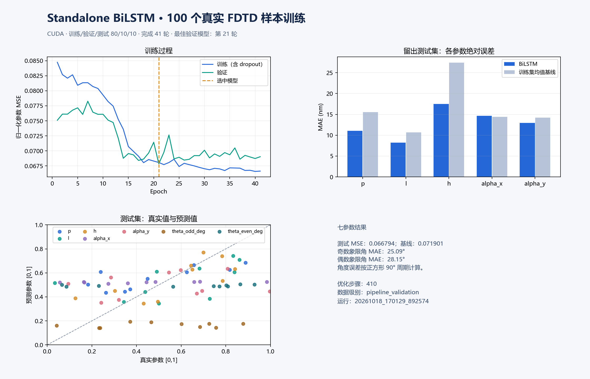

# BiLSTM Spectrum

独立的双向 LSTM 光谱逆向模型，用反射光谱预测 As₂Se₃ 四聚体的七个结构参数。项目不依赖 Metaformer、Lumerical 或其他项目目录。

模型流程：**1000 点原始反射率 → 100 个分块 → 128 维共享投影与位置编码 → 两层 BiLSTM（每方向 64 维）→ LayerNorm 与平均池化 → 七参数回归头**。唯一的序列编码器是 BiLSTM；分块投影用步长等于窗口长度的 Conv1d 实现，没有 ResNet 或 Transformer。初版保留原有输入表示，不进行平滑、去背景、导数或谷形对齐。

输出顺序为 `P, L, H, dX, dY, theta_odd_deg, theta_even_deg`，前五项为 nm，后两项为 deg。两组角分别按正方形的 90° 周期计算误差。尺寸边界和波长网格随检查点保存。

## 运行

在 PyCharm 中打开本项目根目录。本机解释器可选 `D:\Anaconda3\envs\transformer_env\python.exe`，已经安装所需包。其他环境使用 `python -m pip install -r requirements.txt`；GPU 使用需安装与机器匹配的 PyTorch。

- `01 Train standalone BiLSTM`：使用附带的 100 条样本训练。
- `02 View BiLSTM results`：训练完成后查看学习曲线和测试集误差。

也可以在项目根目录运行：

```powershell
python train.py --config configs/train_au100_100.json
python plot_training.py --output-root runs/au100_bilstm_100
python predict.py --sample-id 0
python -m unittest discover -s tests -v
```

训练逐轮输出进度，并更新 `runs/au100_bilstm_100/latest_run.json` 及运行目录中的 `status.json`。中断后使用 `python train.py --config configs/train_au100_100.json --resume <运行目录>`。续训核对配置、数据校验值和实现校验值；每次新训练使用独立目录。

## 数据与评估

`examples/au100_metal8_100/` 附带此前 1.0 生成器计算的 100 条真实 FDTD 光谱及原始 `job.json`。数据校验值为 `591ca0f4d9f4fc0be9803f3a566f72eee1ee3ac871ad9d03472b93a732aed0e3`，保留原有 80/10/10 划分，不重新打乱划分。随机种子 42；最多 100 轮、batch=8、AdamW 学习率 0.0003，验证误差调度学习率并早停。测试集不参与选轮次或调参。

主要评价为结构参数归一化 MSE、各尺寸 MAE 和周期角度 MAE，并与仅使用训练集标签均值的常数基线比较。旧 ResNet + Metaformer 的结果只作为历史参照；两者模型容量不同，不是严格的等参数量比较。

这些数据保留 `pipeline_validation` 标记。本次验证模型是否能从现有数值数据学习结构关系，不证明真实 Au 材料损耗、器件性能或预测结构光谱的准确性。逆向映射可能多解，结构参数误差也不等于光谱误差。100 条样本仅含 10 条测试数据。

## 已完成的 100 样本验证

| 模型 | 参数量 | 测试集结构参数 MSE |
|---|---:|---:|
| 训练集标签均值基线 | — | 0.071901 |
| 独立 BiLSTM | 235,143 | 0.066794 |
| 历史 ResNet + Metaformer | 4,081,415 | 0.065050 |

BiLSTM 完成 41 轮、410 次优化更新，按验证集选中第 21 轮。测试 MSE 比均值基线低约 7.10%，尚未超过历史模型；参数量约为历史模型的 5.76%。两个角度的测试 MAE 约为 25.09°、28.15°。配对测试样本自助重采样的 MSE 收益 95% 区间约为 [-0.00829, 0.01802]，包含零，因此目前不能确认稳定的泛化收益。此诊断未用于调参或选择模型。



结果保存在 `results/au100_seed42/`；便于 CPU 推理的权重为 `models/au100_seed42.pt`。100 条数据全部重载推理后，与保存的 GPU 预测最大绝对差约为 1.79×10⁻⁷；9 项软件测试通过，包括双向梯度、样本状态独立、检查点重载与精确断点续训。FP32 评估关闭 TF32，训练仍使用 AMP。结果摘要和完整指标分别见 `summary.json`、`metrics.json`。

可用 `python export_run.py --run <运行目录>` 重新核对并导出同一示例批次的训练结果。新批次数据可放入忽略提交的 `data/`，并复制训练配置另设输出目录；不混合不同结构或材料版本的数据。

数据读写、训练完整性检查和指标代码沿用了既有项目的实现并改为本项目内的独立模块，来源记录见 `SOURCE_PROVENANCE.json`。
